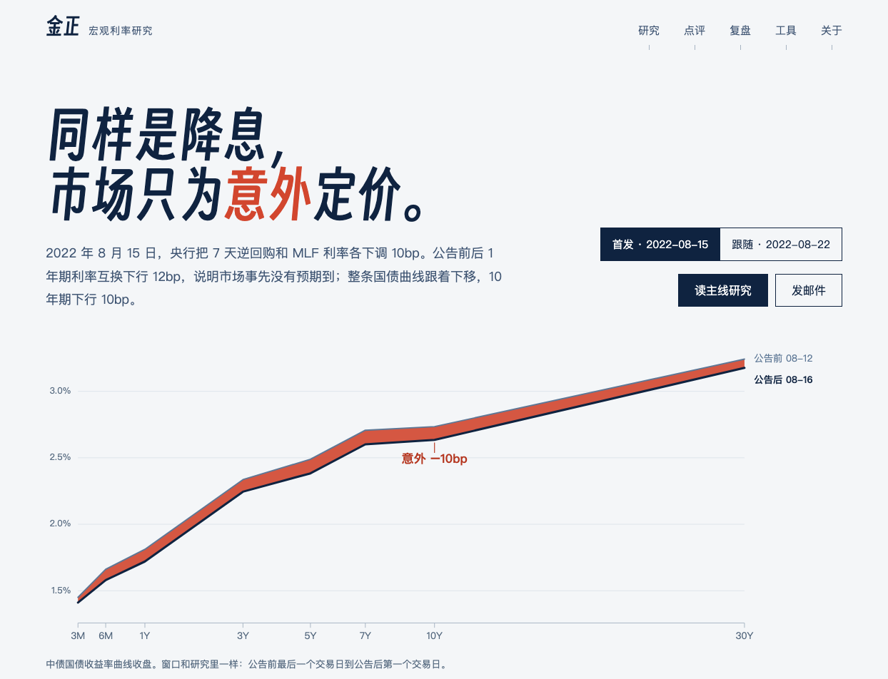
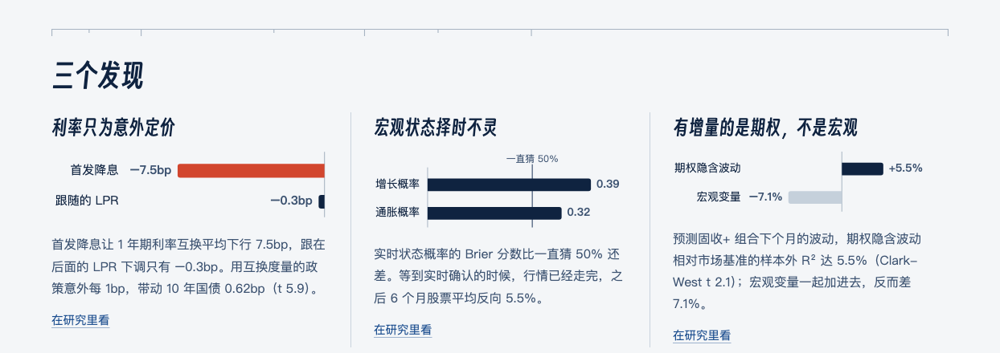

### 金正 Zheng Jin · 宏观利率研究

我研究一个问题：**宏观信息在市场价格之外，能给固收组合带来什么增量。**
我的回答：宏观信息要和市场已经反映的预期比，才谈得上增量。

**在这里看**

- [研究网站](https://joyzen2.github.io)：主线研究、数据与政策点评、专题复盘
- [macro-rates-research](https://github.com/Joyzen2/macro-rates-research)：研究代码、测试和汇总结果
- [bond-analytics](https://github.com/Joyzen2/bond-analytics)：债券计算，久期、凸性、关键期限久期、票息和骑乘
- [quant-research-agent](https://github.com/Joyzen2/quant-research-agent)：投研 Agent，自动取数、成文、核验数字

**背景**：利物浦大学金融计算硕士在读（在西交利物浦大学就读），本科是计算机科学与技术；2025 年在中诚信托做量化研究员助理。常用 Python（pandas、statsmodels、cvxpy）和 SQL。全英文教学背景，雅思口语 7。

**荣誉和成果**：发明专利一项（已公开，CN119606312A）；IEEE TrustCom 2024 国际会议论文；第六届江苏省大学生生物医学工程创新设计竞赛二等奖；西浦（太仓）研究峰会三等奖（创新类，前 10%）。

**联系**：zheng.jin20@student.xjtlu.edu.cn
